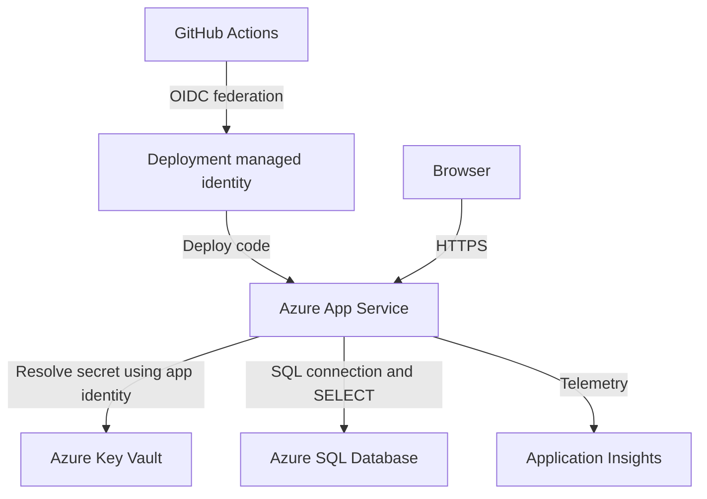

# Azure Employee Directory

A Node.js and Express application hosted on Azure App Service that reads employee records from Azure SQL Database. The SQL connection string is stored in Azure Key Vault and resolved through the Web App's system-assigned managed identity. GitHub Actions deploys the application using OpenID Connect (OIDC), and Application Insights collects request telemetry.

## Project links

- [Live application](https://rahulp-employee-web-1104-gkc4bka9eff4djb8.southindia-01.azurewebsites.net/)
- [GitHub repository](https://github.com/rahulp-ht/azure-employee-directory)

## Implemented features

- Display employee records from `dbo.Employees`.
- Retrieve the SQL connection string through an App Service Key Vault reference.
- Deploy automatically from `main` using GitHub Actions and OIDC.
- Collect HTTP request telemetry in Application Insights.

The implemented application reads records. Database inserts can be performed separately by an authorized SQL administrator.

## Architecture



## Azure resources

| Resource | Name or purpose |
|---|---|
| Project resource group | `rg-azure-final` |
| App Service | `rahulp-employee-web-1104` |
| SQL logical server | `rahulp-employee-sql-1104` |
| SQL database | `employee-directory-db` |
| Key Vault secret | `sql-connection-string` |
| Application Insights | `appi-employee-directory` |
| New deployment identity | `id-employee-github-deploy` |
| Previous deployment identity | `oidc-msi-8592` |

Resource placement should be checked in Azure Portal after any resource-group moves. The new identity and its federated credential have been created; switching the repository secret and verifying deployment completes the identity migration.

## Identity and permissions

Two identities serve separate purposes:

- **Deployment identity:** GitHub Actions exchanges its short-lived OIDC token for an Azure access token. Assign `Website Contributor` to this identity at the Web App scope.
- **Web App system-assigned identity:** Resolves the SQL secret from Key Vault. Grant secret-read access, such as `Key Vault Secrets User` when the vault uses Azure RBAC.

The application connects to SQL as `employee_app` using the connection string. It does not currently authenticate to SQL using managed identity.

The original database configuration granted `employee_app` `SELECT` on `dbo.Employees`. Verify effective permissions before relying on read-only enforcement, especially if additional grants have been applied.

```sql
EXECUTE AS USER = 'employee_app';
SELECT
    HAS_PERMS_BY_NAME('dbo.Employees', 'OBJECT', 'SELECT') AS CanRead,
    HAS_PERMS_BY_NAME('dbo.Employees', 'OBJECT', 'INSERT') AS CanInsert;
REVERT;
```

Expected for the read-only demonstration: `CanRead = 1` and `CanInsert = 0`.

## Application configuration

Configure these under **Azure Portal → Home → App Services → rahulp-employee-web-1104 → Settings → Environment variables → App settings**.

| Setting | Purpose |
|---|---|
| `SQL_CONNECTION_STRING` | Key Vault reference to the SQL connection secret |
| `APPLICATIONINSIGHTS_CONNECTION_STRING` | Connection string for `appi-employee-directory` |

Key Vault reference format:

```text
@Microsoft.KeyVault(SecretUri=https://<vault-name>.vault.azure.net/secrets/sql-connection-string/)
```

Store real connection strings and passwords outside Git. Do not commit `.env` files, tokens, or secret values.

## Run locally

Prerequisites: Git, Node.js with npm, network access to Azure SQL, and an authorized SQL connection string. Use the Node.js version configured in the deployment workflow and App Service.

```bash
git clone https://github.com/rahulp-ht/azure-employee-directory.git
cd azure-employee-directory
npm ci

# Enter the value privately. This avoids placing it directly in shell history.
read -rsp 'SQL connection string: ' SQL_CONNECTION_STRING
echo
export SQL_CONNECTION_STRING

node server.js
```

Open the localhost address reported by the application. An App Service Key Vault reference is resolved by Azure; local Node.js needs an actual connection string supplied securely. Your local IP must be permitted by the SQL network configuration.

After testing:

```bash
unset SQL_CONNECTION_STRING
```

## GitHub Actions deployment

The workflow deploys changes from `main`. Configure repository secrets under **GitHub → repository → Settings → Secrets and variables → Actions**.

| Secret | Value |
|---|---|
| `AZURE_CLIENT_ID` | Client ID of the active deployment managed identity |
| `AZURE_TENANT_ID` | Microsoft Entra tenant ID |
| `AZURE_SUBSCRIPTION_ID` | Azure subscription ID |

The workflow needs `id-token: write` for OIDC and `contents: read` for checkout. These IDs identify the Azure environment; authentication relies on the trusted GitHub token rather than an Azure client password.

The configured federation uses:

| Field | Value |
|---|---|
| Issuer | `https://token.actions.githubusercontent.com` |
| Audience | `api://AzureADTokenExchange` |
| Repository | `rahulp-ht/azure-employee-directory` |
| Trusted branch | `main` |

The federated subject must exactly match the subject GitHub issues for the workflow. Preserve the working credential's subject, including immutable owner and repository IDs where present.

To switch deployment to the new identity:

1. Assign `id-employee-github-deploy` the Web App's `Website Contributor` role.
2. Update `AZURE_CLIENT_ID` to its Client ID.
3. Rerun the deployment workflow and verify Azure login and deployment succeed.
4. Retain the previous identity until the replacement deployment is verified.

## Development workflow

Work on `dev`, validate changes, and open a pull request into `main`.

```bash
git switch dev
git pull --ff-only origin dev
# Edit files with vim.
node --check server.js
git diff --check
git add <changed-files>
git commit -m "Describe the change"
git push origin dev
gh pr create --base main --head dev
```

Review and merge the PR after validation. The merge to `main` triggers deployment. The current OIDC credential trusts `main`; it does not authorize deployment directly from `dev`.

## Monitor requests

Open **Azure Portal → Home → search appi-employee-directory → select Application Insights → Monitoring → Logs → KQL mode**.

Recent requests with India time:

```kusto
requests
| where timestamp > ago(30m)
| where url contains "rahulp-employee-web-1104"
| extend TimeIST = datetime_utc_to_local(timestamp, "Asia/Kolkata")
| project TimeIST, name, resultCode, duration, url
| order by TimeIST desc
| take 20
```

Average response time in milliseconds:

```kusto
requests
| where timestamp > ago(1h)
| where url contains "rahulp-employee-web-1104"
| summarize AverageResponseMs = avg(duration) by bin(timestamp, 5m)
| render timechart
```

In this Application Insights `requests` table, `duration` is numeric milliseconds. Original timestamps are UTC; converting a query column changes the presentation, not the stored time.

## Troubleshooting

| Symptom | Check |
|---|---|
| `Could not load employees` | Open App Service → Monitoring → Log stream, send a fresh request, and inspect `Employee query failed`. |
| `ETIMEOUT` | Determine whether connection or query execution timed out. Check SQL availability, firewall/network access, and the full error message. |
| No telemetry | Check the Application Insights connection string and confirm the deployed app has active instrumentation. |
| Paired request records | Check for overlapping App Service autoinstrumentation and code-based instrumentation. Compare fresh records and `sdkVersion`. |
| OIDC login fails | Verify the Client ID, tenant, issuer, audience, and exact federated subject. |
| Deployment fails after a resource move | Recheck the workflow's resource references and deployment role assignment at the new Web App resource ID. |

If using code-based `useAzureMonitor()` instrumentation, avoid also enabling a second App Service monitoring agent. Keep `APPLICATIONINSIGHTS_CONNECTION_STRING` when disabling an overlapping agent.

HTTP `304` means the browser can reuse a cached response; it does not independently verify a successful database read. Use a fresh request and application logs when diagnosing SQL failures.

```bash
curl -i https://rahulp-employee-web-1104-gkc4bka9eff4djb8.southindia-01.azurewebsites.net/
```

## Cost and cleanup

Review **Azure Portal → Home → Subscriptions → Azure subscription 1 → Cost Management → Cost analysis**. Include all resource groups containing project dependencies when calculating the complete cost.

App Service plan pricing, SQL compute/storage, Key Vault operations, and monitoring usage can contribute to charges. Stopping the Web App does not necessarily stop App Service plan billing.

Before deleting a resource group, verify that it contains only resources you intend to remove. Preserve any required data and check for project resources left in other groups.

employee.therahulpatil.in - DNS
